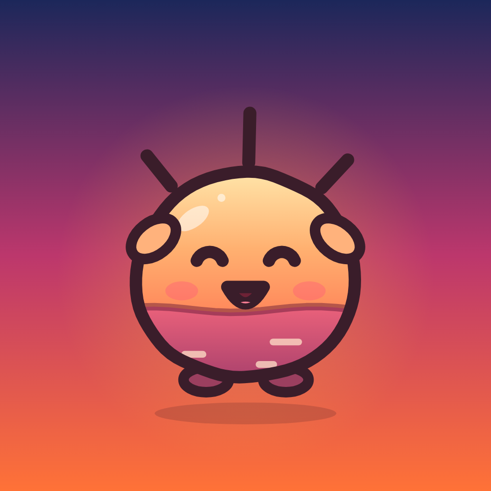
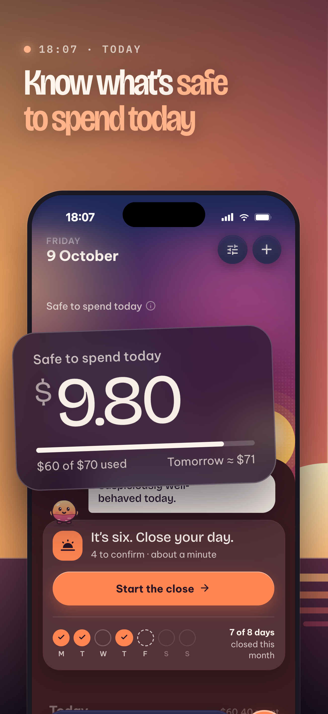
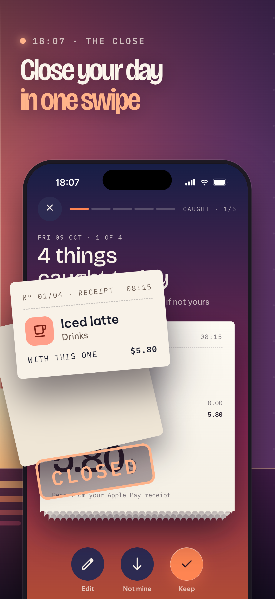
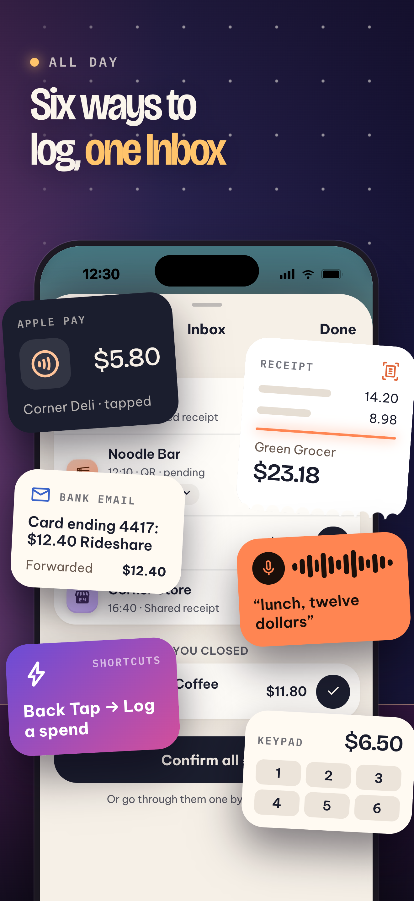
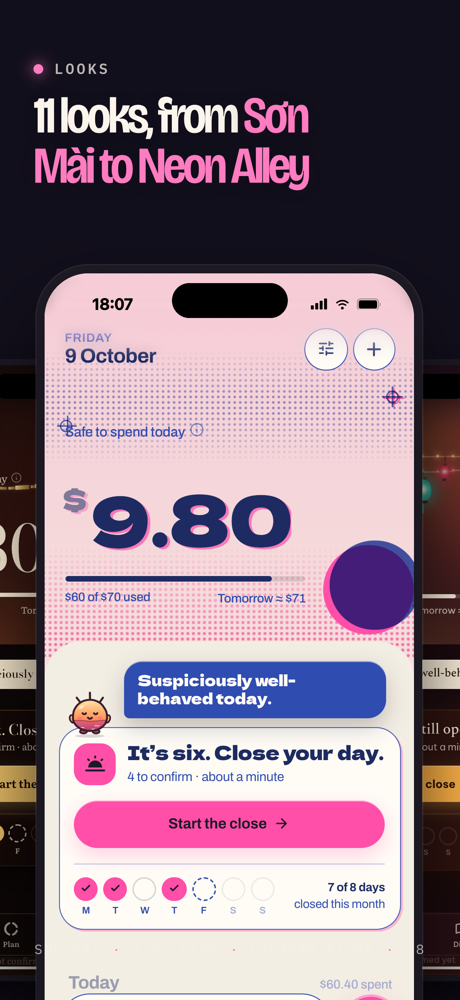

<div align="center">



# 6pm

**Close your day at six. Wake up to one number.**

A daily money ritual for iPhone. 6pm catches what you spend all day, you swipe once at six to close
the day, and tomorrow morning you get one number: what's safe to spend today.

[at6pm.app](https://at6pm.app) · [Tiếng Việt](https://at6pm.app/vi) · On the App Store 6 Nov 2026, 18:00

</div>

<p align="center">
  
  
  
  
</p>

## The idea

Most budget apps want an hour a week. 6pm wants one minute a day.

- **One number.** Safe to spend today, worked out from your pay, your bills and what you've spent.
  Future you is paid first; everything else is split across the days to payday.
- **Caught all day.** Apple Pay taps, receipt photos, forwarded bank emails, VietQR scans, your voice
  and a quick keypad all land in one inbox.
- **The close.** At six, swipe through the day in about a minute: keep, edit or not mine. Done.
- **Ask before you spend.** "Can I afford dinner on Saturday?" is answered from your own numbers.
- **Plan and Diary.** Bills and pots fill each pay cycle; every closed day becomes a page.

## Looks and companions

Eleven looks, each with its own type, palette, material and motion, follow your real clock from dawn
to midnight: Basic and Golden Hour for everyone, six classic looks and three living scenes that move
with the hour. Six companions (the Sunset, Midnight Sun, Nhang, Bánh Bao, Giọt and Hạc Giấy) keep you
company in seven moods, and your Home Screen icon can follow the one you pick. Serious mode takes the
jokes, the colour and the companion away.

## Private by design

- 6pm never asks for a bank login and never moves money. It only counts.
- Your records live on your iPhone. Backup is end-to-end encrypted; the key stays in your iCloud
  Keychain.
- Ask can run on the iPhone itself, offline.
- The close, capture and privacy are free forever.

## Inside this repo

A pnpm monorepo, TypeScript throughout.

| Path | What it is |
| --- | --- |
| `apps/mobile` | The iPhone app: Expo and React Native, Reanimated and Skia for motion, SwiftUI widgets, Live Activities and a share extension in `targets/` |
| `apps/api` | The API at `/api`: Hono on Cloudflare Workers with D1 and R2 |
| `apps/web` | The website at [at6pm.app](https://at6pm.app): Astro on Cloudflare Workers |
| `packages/domain` | Money, the pay cycle, the daily number, close time and the parsers (VietQR, amounts, receipts) |
| `packages/theme` | The looks, time-of-day palettes, colour tokens and motion curves |
| `packages/i18n` | English and Vietnamese catalogues |
| `design/prototype` | The interactive design the app is built to, screen for screen |
| `docs` | Product decisions, tech decisions and the design system |

## Running it

You need Node 24, pnpm 12 and, for the app, Xcode with an iOS simulator.

```sh
pnpm install
pnpm test          # unit tests for every package
pnpm typecheck
```

The app (a development build, on the simulator):

```sh
cd apps/mobile
npx expo prebuild -p ios --clean
npx expo run:ios --no-bundler --device "iPhone 18 Pro"
EXPO_LOCAL_RUNTIME=1 npx expo start --dev-client
```

The API and the website:

```sh
pnpm --filter @6pm/api dev
pnpm --filter @6pm/web dev
```

Server secrets are listed by name in `.env.example`.

## Contributing

Read [CLAUDE.md](CLAUDE.md) first: it is the working contract for anyone, human or agent, changing
this code. [docs/product-decisions.md](docs/product-decisions.md) says what 6pm does,
[docs/tech-decisions.md](docs/tech-decisions.md) how, and
[docs/design-system.md](docs/design-system.md) how it looks.

---

<p align="center">Made in Saigon by Odd Eggs Studio.</p>
